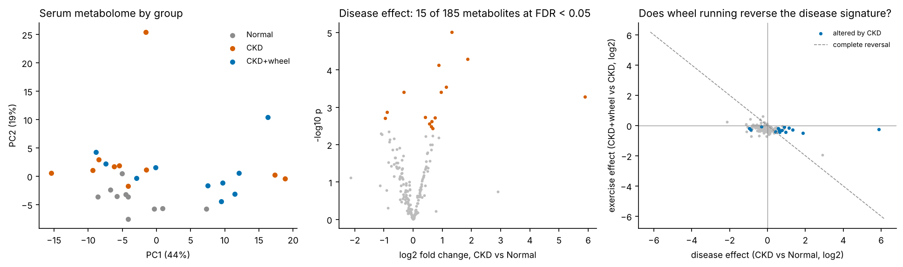

# Serum metabolomics of chronic kidney disease with and without voluntary wheel running

This repository holds the code for an analysis of a targeted serum metabolomics data set from an animal study of chronic kidney disease (CKD), in which animals were assigned to one of three groups of ten: normal controls, CKD without exercise, and CKD with access to an activity wheel. The analysis asks which circulating metabolites are altered by CKD, whether voluntary wheel running changes the serum metabolome of animals with CKD, and whether exercise returns the metabolites that are disturbed by disease toward their normal concentrations.

## Data availability

The study to which these samples belong has been published (Avin et al., 2019; Avin et al., 2021), although the serum metabolite table itself is not included in this repository. Only the code, aggregate summary statistics, and a summary figure are public; results for individual metabolites are written to a folder that is excluded from version control. To run the analysis, place `Kstudy_serum.csv` in `data/private/`.

```
pip install -r requirements.txt
python scripts/01_serum_metabolomics.py
```

## Design and methods

The panel reports 188 metabolites in 30 serum samples run on a single plate: 40 acylcarnitines, 21 amino acids, 21 biogenic amines, 14 lysophosphatidylcholines, 76 phosphatidylcholines, 15 sphingomyelins, and total hexose. Three biogenic amines had the same value in every sample and were removed, which left 185 metabolites. Concentrations were log2-transformed, each pair of groups was compared with Welch's t-test for every metabolite, and p-values were adjusted with the Benjamini-Hochberg procedure across the 185 metabolites within each comparison. A Mann-Whitney test was run alongside as a check that the findings do not depend on the distributional assumption.

## Findings

### 1. CKD produces a focused set of changes

Fifteen metabolites differ between CKD and normal animals at a false discovery rate below 0.05, twelve higher and three lower, and all fifteen are also significant by the Mann-Whitney test. The changes are concentrated among the biogenic amines (4 of 18), which include established markers of renal function, with further changes among the sphingomyelins (3 of 15), acylcarnitines (3 of 40), lysophosphatidylcholines (2 of 14), phosphatidylcholines (2 of 76), and amino acids (1 of 21).

### 2. Wheel running does not measurably change the serum metabolome of animals with CKD

No metabolite differs between exercised and sedentary CKD animals after correction for multiple testing, and only 10 of 185 reach an unadjusted p-value below 0.05, which is close to the number expected by chance.

### 3. Exercise moves the disease signature toward normal only slightly

Of the fifteen metabolites altered by CKD, twelve shift in the direction of normal with wheel running, although the median shift is 27% of the disease effect, none of the fifteen is significantly changed by exercise, and nine remain significantly different from normal in the exercised animals. Across all metabolites, the disease effect and the exercise effect are negatively correlated (r = -0.39).

### 4. Exercised CKD animals differ from normal animals more broadly than sedentary CKD animals do

Sixty-four metabolites differ between exercised CKD animals and normal controls, 57 of them lower, drawn mainly from the phosphatidylcholines (26 of 76), acylcarnitines (11 of 40), amino acids (10 of 21), and lysophosphatidylcholines (9 of 14). This arises because every metabolite class is modestly lower in the exercised group than in the sedentary CKD group (mean log2 differences between -0.13 and -0.29), a broad downward shift that is too small to be significant on its own and becomes significant only when it is added to the disease effect. Such a uniform shift could reflect a real effect of exercise on circulating lipids and amino acids, and it could equally reflect a difference in feeding state or sample handling between groups, which this design cannot separate.



## Limitations

Each group has ten animals and all samples were run on one plate, so modest effects of exercise would go undetected and plate-level artefacts cannot be assessed. No information on fasting status or time of collection was available, which bears directly on the interpretation of the fourth finding. Metabolite classes are assigned from the panel's naming convention.

## Related publications

The three groups analysed here correspond to the design of a published rat model of CKD in which animals were given ten weeks of voluntary wheel running. Avin et al. (2019) reported the effects of wheel running on serum biochemistry, physical function, and bone, and Avin et al. (2021) reported targeted metabolomics of the soleus and extensor digitorum longus with a panel of approximately 180 metabolites drawn from the same chemical classes as the serum panel analysed here. The absence of a detectable exercise effect in serum is consistent with the muscle findings of Avin et al. (2021), in which amino acid-related compounds that were reduced by CKD were not restored by physical activity.

Avin, K. G., Allen, M. R., Chen, N. X., Srinivasan, S., O'Neill, K. D., Troutman, A. D., Mast, G., Swallow, E. A., Brown, M. B., Wallace, J. M., Zimmers, T. A., Warden, S. J., & Moe, S. M. (2019). Voluntary wheel running has beneficial effects in a rat model of CKD-mineral bone disorder (CKD-MBD). *Journal of the American Society of Nephrology, 30*(10), 1898–1909. https://doi.org/10.1681/ASN.2019040349

Avin, K. G., Hughes, M. C., Chen, N. X., Srinivasan, S., O'Neill, K. D., Evan, A. P., Bacallao, R. L., Schulte, M. L., Moorthi, R. N., Gisch, D. L., Perry, C. G. R., Moe, S. M., & O'Connell, T. M. (2021). Skeletal muscle metabolic responses to physical activity are muscle type specific in a rat model of chronic kidney disease. *Scientific Reports, 11*, Article 9788. https://doi.org/10.1038/s41598-021-89120-8

## Acknowledgement

The data were generated in the laboratory of Dr. Thomas O'Connell at the Indiana University School of Medicine. The analysis code and interpretation in this repository are by Patricia Kamanda.
